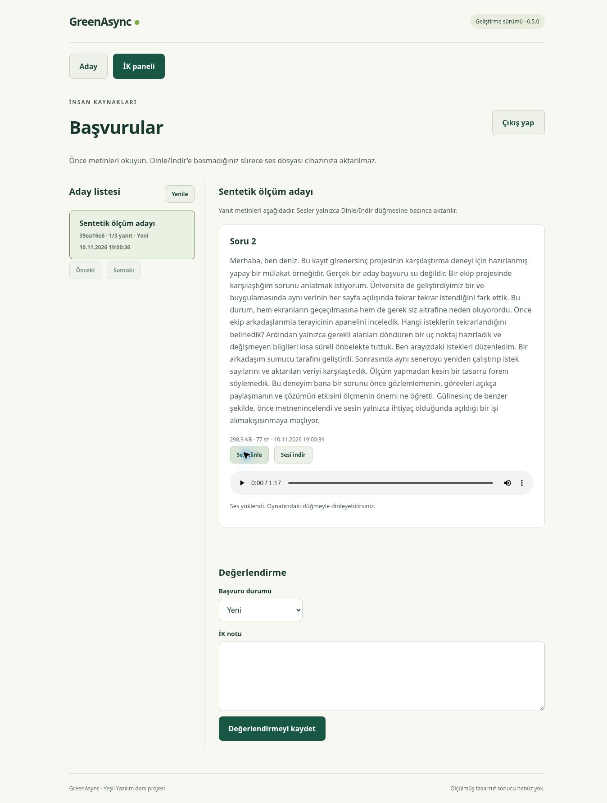

# GreenAsync — 10 Kasım 2026 ölçüm raporu

**Durum:** Yerel üretim derlemesinde gerçek İK ekranı ölçüldü. Girdi, depodaki
77 saniyelik Türkçe **sentetik** örnektir; kamera çekimi değildir. EcoGrader
puanı ve Lighthouse puanı bu raporda yoktur. Karbon değerleri model tahminidir.

**Sonraki güncelleme:** Lighthouse deneyi GitHub test makinesinde tamamlandı.
[Gerçek önce/sonra raporu](../lighthouse-2026-11-10/README.md). Aşağıdaki
yerel başarısız deneme bilgisi, bu İK deneyinin tarihsel kaydı olarak korundu.

## Ne yaptık?

1. React ve NestJS üretim derlemelerini hazırladık. Disk tabanlı PGlite ve ayrı,
   yalnızca sentetik veri içeren bir ölçüm veritabanı kullandık.
2. Aynı örnek videodan mono Opus ses çıkardık. Sesi uygulamanın gerçek
   `/api/answers/2/transcribe` ucuna gönderdik; yerel Whisper metin üretti,
   ses ve metin veritabanına/dosyaya kaydedildi. API dönüşüm+kayıt işlemi
   bu tek koşuda 3,07 saniye sürdü.
3. Gerçek tarayıcıda İK listesine girip adayın metnini açtık. Sonra “Sesi dinle”
   düğmesine bastık; aynı kartta tekrar bastık. Sayfayı yenileyerek bu akışı
   üç kez yaptık. Oturum ve liste yüklemeleri ölçüm kapsamı dışında bırakıldı.
4. Aynı tarayıcıda kontrollü video sayfasını üç kez açıp videonun tamamını
   `fetch` ile yükledik. Her koşuda yeni sayfa kullanıldı, yanıtlar `no-store` idi.
5. Ölçüm sunucusu her ilgili yanıtta gönderilen gövdenin gerçek bayt sayısını
   tuttu. UUID'ler redakte edildi; çerezler, başlıklar ve erişim anahtarları
   kanıtlara yazılmadı. Bu rapor HAR `_transferSize` ölçümü değildir.

## İK ekranı: üç koşunun sonuçları

| İşlem | Koşu 1 | Koşu 2 | Koşu 3 | Medyan |
|---|---:|---:|---:|---:|
| Adayı açma: metin + yanıt bilgileri | 1.571 B | 1.571 B | 1.571 B | 1.571 B |
| Sesi ilk açma: ek ses gövdesi | 305.418 B | 305.418 B | 305.418 B | 305.418 B |
| Aynı kartta tekrar açma: ek ses gövdesi | 0 B | 0 B | 0 B | 0 B |
| Kontrollü videoyu tam yükleme | 1.125.679 B | 1.125.679 B | 1.125.679 B | 1.125.679 B |

Metin koşullarında **0 ses isteği**, ilk ses açılışlarında **1 ses isteği**,
aynı kartta tekrarda **0 yeni ses isteği** gözlendi. Son satır tüm sesin
yeniden oynatılmasının enerji maliyetini ölçmez; yalnızca ek sunucu ses
yanıtının gönderilmediğini gösterir. Sayfa yenilenirse ses yeniden alınabilir.

Metin ve sesi birlikte açmanın yanıt gövdeleri toplamı **306.989 B** oldu.
Bu sentetik video örneğine göre, yalnızca metin açmada ilgili yanıt gövdesi
%99,8604; metin+sesi açmada %72,7285 daha küçüktür. Bunlar **seçili yanıt
gövdelerinin karşılaştırmasıdır**: toplam mülakat/ağ/enerji tasarrufu değildir.

Ölçülen gövdelerde HTTP başlıkları, TLS/TCP ek yükleri, giriş, aday listesi,
ilk HTML/JS/CSS yüklemesi, adayın ilk ses yüklemesi ve sunucu hesaplaması yoktur.
Video sayfası ticari bir video mülakat uygulaması değildir. Sonuç gerçek
kamera kayıtlarına veya başka video kalitelerine genellenemez.

Ham sayılar: [ui-results.json](ui-results.json), [CSV](ui-results.csv).
Redakte istek kanıtları: [response-evidence.json](response-evidence.json).

## Depolanan dosya yükü ve işlem süresi

Bu ortamda PyAV 15.1.0 ile aynı girdiden tekrar ölçüldü. Önceki 9 Kasım
örneğinde farklı PyAV çıktısı nedeniyle çok küçük bayt/metin farkları vardır.

| Ölçüt | Sonuç |
|---|---:|
| Kaynak video | 1.125.679 B |
| Opus ses | 305.418 B |
| Whisper'ın gerçek metninin UTF-8 boyutu | 1.254 B |
| Ses + metin dosya yükü | 306.672 B |
| Bu örnekte dosya yükü azalması | %72,757 |
| Worker/model açılışı | 0,596 sn |
| İlk dönüşüm | 2,170 sn |
| İkinci dönüşüm | 2,226 sn |
| Üçüncü dönüşüm | 2,138 sn |
| Isınmış iki dönüşümün medyanı | 2,182 sn |

API dönüşüm+kayıt süresi (3,07 sn), yalnızca model isteği süresiyle aynı ölçüt
değildir. Model kurulum indirmesi bu sürelere dahil değildir. DB satırları,
indeks, yedek, dosya sistemi ve model dosyaları dosya yükü hesabının dışındadır.
Ses, İK dinlemese de sunucuda saklanır. Süreler Linux test makinesine aittir;
kullanıcının Windows bilgisayarında farklı çıkabilir.

[Gerçek çalıştırma verileri](media-results.json).

## Metin kalitesi: ölçülen ödün

Önceden seslendirilen referans ile gerçek tanıma çıktısı karşılaştırıldı.
NFC, Türkçe küçük harf ve noktalama temizliği sonrasında 144 referans kelimeye
karşılık 34 kelimelik düzenleme gerekti: **WER %23,61**. Tek sentetik ses
örneği ve `tiny` modeli için geçerlidir; genel Türkçe doğruluk oranı değildir.
WER, doğrudan “kelimelerin yüzde kaçı doğru” ifadesine dönüştürülmemelidir.

Özellikle özel adlarda, kelime birleştirmede ve bazı teknik kelimelerde
hatalar var. Bu nedenle “eksiksiz ve hatasız döküm” iddiası kullanılamaz;
aday kontrolü/düzeltmesi gerekir. Daha büyük modelin doğruluk–süre–kaynak
dengesini karşılaştırmak sonraki deneydir. Bu ölçümde model değiştirilmedi.

[Gerçek tanıma çıktısı](transcript.txt) ·
[Seslendirilen referans](../../../../samples/synthetic-interview/reference.txt)

## CO2.js: ayrı ve varsayımsal karbon hesabı

Green Web Foundation **CO2.js 0.19.0**, **SWD v4**, `perByteTrace` kullanıldı.
Ölçülen yanıt gövdelerinin varsayımsal internet aktarımına, varsayılan global
494 gCO₂e/kWh yoğunlukları ve `green=false` varsayımı uygulandı.

| Seçili yük | Model tahmini (gCO₂e) |
|---|---:|
| Metin + yanıt bilgileri | 0,000233 |
| Metin + ses | 0,045496 |
| Video | 0,166826 |

**Bu sayılar test makinesinde ölçülmüş emisyon değildir.** Yerel loopback
testinin gerçek karbonu diye sunulamaz. Ses kaydı, Whisper hesaplaması,
ilk yükleme, model indirme, saklama süresi ve diğer sayfa kaynakları bu
girdilerde ölçülmediği için toplam işe alım karbonu hesaplanmış değildir.
Varsayımlar ve aracın ham çıktısı [carbon-estimates.json](carbon-estimates.json)
dosyasında saklandı. EcoGrader puanı veya raporu olarak etiketlenemez.

## Sayfa ağırlığı ve tamamlanamayan araçlar

Vite üretim çıktısı gzip ile: JavaScript yaklaşık **79,94 kB**, CSS **2,42 kB**,
HTML **0,35 kB**. Bunlar derleme/dosya boyutlarıdır; Lighthouse performans
puanı veya tam oturum ağ ölçümü değildir.

- **Lighthouse 13.6.0 denendi:** ölçüm ortamı Chromium'un gerekli singleton
  soketini açmasına izin vermedi (`socket() Operation not permitted`). Puan
  oluşmadı; boş veya uydurma puan kullanılmadı. Kullanıcının Windows Chrome
  ortamında veya uygun bir CI/host üzerinde ayrıca çalıştırılmalı.
- **EcoGrader çalıştırılmadı:** dışarıdan erişilebilen bir yayın adresi yok.
  Yerel `127.0.0.1` adresi EcoGrader için yayın adresi sayılmaz. Site yayına
  çıktıktan sonra tarih, URL ve gerçek rapor bağlantısı eklenmeli.
- **Elektrik ölçümü yapılmadı:** bu ortamda erişilebilir güç sayacı/RAPL
  bulunmadığından gerçek kWh ve gerçek karbon alanları `null` bırakıldı.

## Sunumda kullanılabilecek anlatım

“77 saniyelik sentetik bir yanıtla uygulamanın İK akışını üç kez ölçtük.
Başvuru açıldığında 1.571 baytlık metin ve yanıt bilgisi geldi; ses isteği
oluşmadı. Sesi açınca ayrıca 305.418 bayt aktarıldı. Aynı kartta tekrar
açmak yeni ses isteği oluşturmadı. Böylece metin öncelikli ve isteğe bağlı
ses aktarımı davranışını doğruladık. Modelin hatalı tanıyabildiği kelimeler
olduğundan aday kontrolünü koruyoruz. Karbon hesabımız varsayımsal bir
model çıktısıdır; gerçek enerji tasarrufu veya tüm mülakatlara genellenen
bir oran iddia etmiyoruz.”

**Sunuma hazır kanıtlar:** üç koşulu bayt tablosu, gerçek İK ekranı, ham JSON/CSV,
model süreleri ve tek örnek WER. **Eksik:** kamera kayıtlı daha geniş karşılaştırma,
yayın adresi/EcoGrader ve doğrudan güç ölçümü. Lighthouse ayrı raporda tamamlandı.



## Tekrarlanabilirlik

Uygulama kaynak sürümü: `10afa81505e9cabe9aa6a3172a9f19d7d01c48ee`.
Eklenen ölçüm araçları bu deneye ait yardımcı dosyalardır; ürün kodu değiştirilmedi.

Mevcut örnek ve modelle dosya/süre ölçümünü yeniden çalıştır:

```powershell
git pull
npm run setup:speech
npm run measure:demo
```

Sunucu ölçüm aracı `scripts/measure-server.mjs` yalnızca yerel ölçüm içindir.
Üretim dağıtım sunucusu olarak kullanılmamalı. `MEASURE_BOOTSTRAP=1` sadece
izole sentetik test DB'sini ve test İK oturumunu hazırlar; gerçek aday DB'siyle
bu modu kullanma. Model hazır olmalı ve 3000 portu boş olmalı. Windows'ta:

```powershell
npm run build
.venv\Scripts\python.exe scripts/measure.py media --video samples/synthetic-interview/yanit.mp4 --transcript samples/synthetic-interview/reference.txt --out measurements/private/ui-input
$env:MEASURE_BOOTSTRAP='1'
npm run measure:serve
```

`ui-input` zaten varsa hazırlık komutunu yeniden çalıştırma.
`http://localhost:4173/benchmark/start-hr`
yalnızca sentetik ölçüm oturumunu açar. İK paneline geçip aynı işlemleri yap.
`measurements/private/ui/phase.txt` dosyasına sırayla `text-1`, `audio-1`,
`replay-1` (ve 2/3) yazarak ilgili eylemi işaretle; video için `video-1/2/3`.
Sayfa ve liste yüklemeleri ayrı tutulur. Sayaç yalnızca gözlenen eylemlerle
birlikte anlamlıdır; boş günlük tek başına sıfır aktarım kanıtı sayılmaz.

Karbon aracını uygulamanın üretim paketine eklemeden ayrı kurmak için:

```powershell
npm install --prefix measurements/private/audit-tools @tgwf/co2@0.19.0
node scripts/estimate-payload-carbon.mjs docs/measurements/results/ui-2026-11-10
```

Kaynaklar:

- [CO2.js model tanımı](https://developers.thegreenwebfoundation.org/co2js/models/overview/)
- [EcoGrader'ın yöntemi](https://ecograder.com/how-it-works)
- [Lighthouse resmi kullanım bilgisi](https://developer.chrome.com/docs/lighthouse/overview/)
